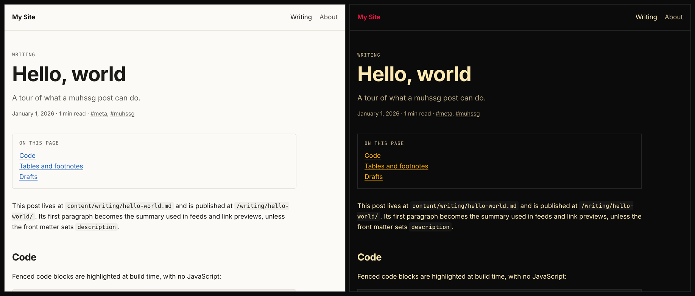

<p align="center">
  
</p>

<p align="center">
  <b>A static site generator for personal sites.</b><br>
  Markdown in, fast static HTML out. One binary, no Node, no runtime.<br>
  <a href="https://apv022.github.io/muhssg/">Website</a> ·
  <a href="https://apv022.github.io/muhssg/docs/guide/">Guide</a> ·
  <a href="docs/reference.md">Reference</a> ·
  <a href="https://github.com/apv022/muhssg/releases">Releases</a>
</p>

<p align="center">
  <a href="https://github.com/apv022/muhssg/actions/workflows/ci.yml"></a>
  <a href="LICENSE"></a>
  <a href="go.mod"></a>
</p>

---

```console
$ muhssg new site my-site
$ cd my-site
$ muhssg serve
serving my-site at http://127.0.0.1:4321/ (drafts: true)
```

muhssg is static first. Pages are plain HTML that works with JavaScript
turned off. When a page needs to be interactive, you write TypeScript or
JavaScript next to your CSS and muhssg bundles it. Change one line in the
config and a different theme gives the whole site a new look.

## Contents

- [Features](#features)
- [Install](#install)
- [A site, folder by folder](#a-site-folder-by-folder)
- [Writing content](#writing-content)
- [Templates](#templates)
- [Shortcodes](#shortcodes)
- [Images](#images)
- [Pagination](#pagination)
- [CSS, JavaScript and TypeScript](#css-javascript-and-typescript)
- [Themes](#themes)
- [Favicons, feeds, sitemap and redirects](#favicons-feeds-sitemap-and-redirects)
- [Commands](#commands)
- [Deploying](#deploying)
- [Coming from Astro](#coming-from-astro)
- [Full reference](docs/reference.md)

## Features

|  |  |
| --- | --- |
| **Content** | Markdown with tables, footnotes, task lists, definition lists and smart quotes. Raw HTML pages when Markdown isn't enough. |
| **Collections** | Every folder in `content/` becomes a collection, with a list page, prev/next links, tags and an RSS feed. |
| **Drafts** | `draft: true` posts show up in `muhssg serve` and never in `muhssg build`. |
| **Shortcodes** | ``, ``, `…` and your own snippets, right inside Markdown. |
| **Images** | Local images are resized into a responsive `srcset` with width/height and lazy loading. Phone photos are rotated correctly and stripped of metadata, including GPS location. |
| **Pagination** | `paginate: 10` splits a collection or tag across `/writing/page/2/`, `/writing/page/3/` and so on. |
| **Syntax highlighting** | Done at build time with no JavaScript, using separate light and dark styles. |
| **Assets** | CSS `@import`s and JS/TS imports are bundled by [esbuild](https://esbuild.github.io), minified and given content-hashed file names. npm packages work if you install them. |
| **Themes** | Layered folders: the site overrides the theme, and a theme can override another theme. A theme can be as small as one CSS file. |
| **Favicons** | One square image becomes `favicon.ico`, the Apple touch icon, Android icons and a web manifest. |
| **SEO** | Canonical links, Open Graph and Twitter tags, a sitemap and `robots.txt`, all generated for you. |
| **Redirects** | HTML redirect pages plus a `_redirects` file for Netlify and Cloudflare Pages. |
| **Dev server** | Rebuilds on save, reloads the browser, and shows build errors in the page. |
| **Safe builds** | Each build goes to a temporary folder and is swapped in only when it succeeds. Deleted pages disappear, and a failed build never leaves a half-written site. |
| **`muhssg check`** | Finds broken links and missing `#anchors` before your visitors do. |

## Install

With Go 1.24 or newer:

```sh
go install github.com/apv022/muhssg@latest
```

Or download a binary for Linux, macOS or Windows from
[Releases](https://github.com/apv022/muhssg/releases) and put it on your `PATH`.

## A site, folder by folder

```
my-site/
├── muhssg.yaml        site config
├── content/           pages: Markdown or HTML
│   ├── index.md       → /
│   ├── about.md       → /about/
│   ├── 404.md         → /404.html
│   └── writing/       a collection
│       ├── _index.md  → /writing/ (list page)
│       └── hello.md   → /writing/hello/
├── templates/         layouts and partials (html/template)
├── assets/            CSS, JS and TS: bundled and hashed
├── static/            copied to the output as-is
├── data/              YAML or JSON, available as .Site.Data
└── themes/            optional layers of templates/, assets/, static/
```

Every folder is optional. A site needs `muhssg.yaml` and at least one page.

## Writing content

````markdown
---
title: Hello, world
description: Shown in lists, feeds and link previews.
date: 2026-01-01
tags: [notes, go]
draft: false
toc: true
---

The first paragraph becomes the summary when there is no description.

## A heading

Code blocks are highlighted at build time:

```go
fmt.Println("hi")
```
````

| Front matter | What it does |
| --- | --- |
| `title`, `description` | Page title and summary. |
| `date`, `updated` | `2026-01-01`, `2026-01-01 14:30` or full RFC 3339. Used for sorting, feeds and the sitemap. |
| `draft` | Leave the page out of production builds. |
| `tags` | Groups pages under `/tags/<tag>/` if the theme has a `tag.html`. |
| `slug`, `permalink` | Change the URL. `permalink: /exactly/here/` wins over everything. |
| `aliases` | Old URLs that should redirect to this page. |
| `layout` | Use `templates/<layout>.html` instead of the default. |
| `image` | Link-preview image for this page. |
| `weight` | Manual ordering when a collection sorts by weight. |
| `toc` | Ask the template to show a table of contents. |
| `noindex` | Keep the page out of the sitemap and tell search engines to skip it. |
| *anything else* | Available as `.Params.yourkey`. |

**Page bundles:** put a post in its own folder as `content/writing/trip/index.md`
and images next to it as `content/writing/trip/photo.jpg`. Then ``
just works.

## Templates

Templates use Go's [`html/template`](https://pkg.go.dev/html/template), which
escapes everything by default. A layout fills in `base.html`:

```html
{{ define "main" }}
<article>
  <h1>{{ .Title }}</h1>
  <time datetime="{{ isoDate .Date }}">{{ date "January 2, 2006" .Date }}</time>
  {{ .Content }}
</article>
{{ end }}
```

```html
<!-- templates/base.html -->
<head>
  <title>{{ fullTitle . }}</title>
  {{ seo . }}
  {{ favicons }}
  {{ css "site.css" }}
  {{ js "app.ts" }}
</head>
<body>{{ block "main" . }}{{ end }}</body>
```

muhssg picks the most specific template it finds:

| Page | Looks for |
| --- | --- |
| Home | `index.html` → `home.html` → `page.html` |
| Standalone page | `page.html` |
| Collection entry | `<collection>/single.html` → `single.html` → `page.html` |
| Collection list | `<collection>/list.html` → `list.html` |
| 404 | `404.html` → `page.html` |
| Tags | `tag.html`, `tags.html` |

Partials live in `templates/partials/` and are included with
`{{ template "partials/header.html" . }}`.

There are 49 template functions, including `collection`, `first`,
`where`, `sortBy`, `groupByYear`, `date`, `markdown`, `truncate`, `asset`,
`absURL`, `active`, `img`, `image` and `jsonify`. They're all listed in the
[reference](docs/reference.md#template-functions).

## Shortcodes

Shortcodes are ready-made snippets you drop into Markdown. muhssg replaces
each one with HTML from a template:

```markdown





Any *Markdown* goes in here.

```

| Built in | Does |
| --- | --- |
| `youtube`, `vimeo` | Privacy-friendly, lazy-loaded video embeds. |
| `figure` | A responsive image with an optional Markdown caption. |
| `img` | A responsive image with control over `sizes` and `class`. |
| `note` | A callout box (`note`, `tip`, `warning` or `danger`). |
| `details` | A collapsible section that works without JavaScript. |

Make your own by adding `templates/shortcodes/<name>.html`. Inside the
template, `.Get "key"` (or `.Get 0` for positional values) reads parameters,
and `.InnerHTML` renders the Markdown between the opening and closing tag.
Files with the same name replace the built-in ones.

Shortcodes don't run inside code blocks or inline code, and
`` prints a shortcode without running it.

## Images

Write images the usual way. Local ones are processed automatically:

```markdown

```

Put `roof.jpg` next to the post (`content/writing/my-post/roof.jpg`) or in
`assets/`. muhssg then:

- **resizes it** to each width in `images.widths` (480, 800, 1200 and 1600
  by default) and writes a `srcset`, so phones download small files. Images
  are never enlarged.
- **adds `width` and `height`**, so the page doesn't jump while it loads, plus
  `loading="lazy"` and `decoding="async"`.
- **rotates phone photos** according to their EXIF orientation.
- **strips metadata** by re-encoding, so camera details and GPS location are
  never published. The original file isn't copied to the output.

In templates, `{{ img "photos/roof.jpg" "Alt text" }}` produces the same
responsive tag, and `{{ (image "photos/roof.jpg").Resize 400 }}` gives you a
single resized image with `.URL`, `.Width` and `.Height`. JPEG and PNG are
resized. GIF and SVG are published as they are. Resized images are cached
between builds.

## Pagination

```yaml
collections:
  writing:
    paginate: 10      # or set paginate: 10 at the top level for every list and tag
```

`/writing/` shows the newest 10 entries, `/writing/page/2/` the next 10, and
so on. List and tag templates get a `.Paginator`:

```html
{{ range .Paginator.Items }}<a href="{{ .URL }}">{{ .Title }}</a>{{ end }}
{{ with .Paginator.NextURL }}<a href="{{ . }}" rel="next">Older</a>{{ end }}
```

`.Paginator` also has `.PrevURL`, `.Links` (for numbered page links),
`.PageNumber` and `.TotalPages`. Without `paginate`, there's a single page
holding every entry, so templates can use `.Paginator.Items` either way.

## CSS, JavaScript and TypeScript

Every top-level `.css`, `.js` or `.ts` file in `assets/` is an entry point.
Files in subfolders, or whose names start with `_`, are only used through
imports.

```
assets/
├── site.css        entry → /_assets/site-7Q2KXJ4M.css
├── _tokens.css     imported by site.css
├── app.ts          entry → /_assets/app-ZB4A3C2E.js
├── islands/
│   └── chart.ts    imported by app.ts
└── img/logo.png    copied → /_assets/img/logo-1a2b3c4d.png
```

- `url(./img/x.png)` in CSS is bundled and hashed. `url(/fonts/x.woff2)` is
  left alone and served from `static/`.
- Scripts are ES modules with code splitting, so code shared between entry
  points is downloaded once.
- Run `npm install some-package` in your site and `import` it from TypeScript.
  esbuild bundles it, and muhssg still doesn't need Node itself.
- Production builds are minified. `muhssg serve` adds inline source maps.

### Adding interactivity with Alpine.js

[Alpine.js](https://alpinejs.dev) suits muhssg well: pages stay static HTML,
and Alpine adds behaviour where you mark it. Install it with npm in your site
folder:

```sh
npm install alpinejs
```

```ts
// assets/app.ts
import Alpine from "alpinejs";

window.Alpine = Alpine;
Alpine.start();
```

```html
<!-- in any template or .html page -->
<div x-data="{ open: false }">
  <button @click="open = !open">Menu</button>
  <nav x-show="open" x-cloak>…</nav>
</div>
```

Add `[x-cloak] { display: none; }` to your CSS so hidden parts don't flash
before Alpine starts. muhssg bundles Alpine into `app.ts`'s output (about
56 KB minified). Commit `package.json` and `package-lock.json`, and have your
host run `npm ci` before `muhssg build`. muhssg itself still doesn't need Node.

## Themes

```yaml
theme: [solar, default]   # first one wins
```

A theme is a folder in `themes/` with any of `templates/`, `assets/`,
`static/` and `data/`. muhssg looks for each file in your site first, then in
each theme in order.

The starter site has two themes. `default` has the templates and layout CSS.
`solar` is a single file, `assets/_tokens.css`, that redefines the colour and
font variables. Putting `solar` first gives the whole site a new look without
touching a template.

<p align="center">
  
  <br><sub>The same page. Left: <code>theme: [default]</code>. Right: <code>theme: [solar, default]</code>.</sub>
</p>

## Favicons, feeds, sitemap and redirects

```yaml
favicon:
  source: favicon.png       # square, 512×512 or larger
  background: "#0b0b0b"     # behind the Apple touch icon
  themeColor: "#0b0b0b"

collections:
  writing:
    feed: true              # /writing/rss.xml
    feedPath: /rss.xml      # or put it somewhere else

redirects:
  /old-page/: /new-page/
```

`{{ favicons }}` writes the matching `<link>` tags, and `{{ seo . }}` adds the
feed links. `sitemap.xml` is always generated. So is `robots.txt`, unless you
ship your own in `static/` or set `robots: false`. Redirects become HTML
redirect pages plus a `_redirects` file.

## Commands

| Command | |
| --- | --- |
| `muhssg new site <dir>` | Start a site from the starter. |
| `muhssg new <collection> "Title"` | Create a dated draft, e.g. `muhssg new writing "Hello"`. |
| `muhssg serve` | Dev server on <http://127.0.0.1:4321> with live reload and drafts. `--port`, `--host`, `--no-drafts`. |
| `muhssg build` | Build into `dist/`. `--out`, `--drafts`, `--base-url` for preview deploys. |
| `muhssg check` | Build into a temporary folder and report broken links and anchors. Exits non-zero if it finds any. |
| `muhssg styles` | List syntax highlighting styles. |
| `muhssg syntax <style> --dark <style>` | Print highlighting CSS, if you'd rather keep it yourself. |

## Deploying

The output is plain files, so any static host works. On hosts that build
for you, install muhssg in the build command:

| Host | Build command | Output folder |
| --- | --- | --- |
| Cloudflare Pages, Netlify | `go install github.com/apv022/muhssg@latest && $(go env GOPATH)/bin/muhssg build` | `dist` |
| GitHub Pages | the [workflow in the reference](docs/reference.md#github-pages) | `dist` |
| Anything else | run `muhssg build` and upload `dist/` | `dist` |

For a site served from a subfolder, such as `https://you.github.io/blog/`, put
the full URL in `baseURL`. Page URLs (`.URL`), asset URLs, feeds, redirects
and root links written in your Markdown all get the `/blog` prefix. In your
own templates, wrap hand-written paths in `relURL`, e.g.
`{{ relURL "/about/" }}`.

## Coming from Astro

| Astro | muhssg |
| --- | --- |
| `src/pages/*.astro` | `content/*.md` or `content/*.html` plus `templates/` |
| `src/content/<collection>/` | `content/<collection>/` |
| `src/layouts/` | `templates/` (`base.html` and layouts) |
| `src/components/` | `templates/partials/` |
| `src/styles/`, `<script>` | `assets/` |
| `public/` | `static/` |
| `astro.config.mjs` `redirects` | `redirects:` in `muhssg.yaml` |
| `@astrojs/rss`, `@astrojs/sitemap` | built in |
| `astro dev` / `astro build` | `muhssg serve` / `muhssg build` |

The one thing muhssg doesn't do is run React, Vue or Svelte components on the
server. Interactive parts are plain TypeScript or JavaScript modules that
enhance the static HTML.

## License

[GPL-3.0](LICENSE). Sites you build with muhssg are yours and can use any
license you like. The GPL covers muhssg itself, not what it generates.
